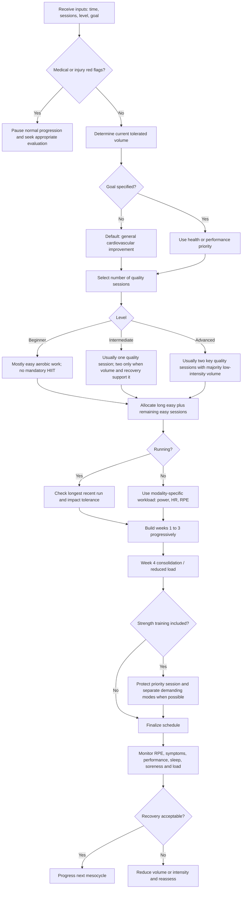

# Evidence-Based Cardiovascular Training: Programming, Progression, Safety, and Concurrent Strength–Endurance Training

## Executive summary

For this report, **“predictable cardiovascular training”** is interpreted as planned, repeatable endurance exercise in which workload can be controlled reasonably well: running, cycling, rowing, elliptical, stair machines, treadmills, and similar modalities. The central programming variables are frequency, duration, intensity, total volume, modality, recovery, and progression.

The evidence supports several conclusions with relatively high confidence:

| Question | Evidence-based conclusion |
|---|---|
| **How much cardio is required for health?** | The WHO recommends **150–300 min/week of moderate aerobic activity or 75–150 min/week vigorous activity**, or an equivalent mixture, for substantial health benefits. This is a public-health target, not an optimal athletic prescription. citeturn19search1turn19search2 |
| **Does higher intensity improve VO₂max more?** | Both continuous moderate training and interval training work. Across 69 RCTs in a 2026 meta-analysis, HIIT produced a modestly greater VO₂max improvement than moderate continuous training, although cardiometabolic risk-factor changes were similar. citeturn16view14 |
| **Is HIIT time-efficient?** | Yes. Recent dose-response evidence suggests substantial VO₂max adaptation can be obtained from relatively short HIIT exposures; older meta-analysis also shows that short/low-volume HIIT works, although ≥2-min intervals and ≥15 min accumulated hard work tend to produce larger VO₂max improvements when maximizing aerobic performance is the goal. citeturn16view5turn16view14 |
| **Should most training be easy?** | For endurance athletes, generally yes, but there is **no scientifically established universal “80/20” rule**. Polarized and pyramidal distributions both work; a 2025 individual-participant network meta-analysis suggested recreational athletes may respond particularly well to pyramidal distributions and more competitive athletes to polarized distributions. citeturn16view12 |
| **How quickly should running volume increase?** | There is no validated universal weekly percentage. Systematic-review evidence linking weekly changes in volume/frequency/intensity to injury is inconsistent. A large 2025 cohort did, however, find higher overuse-injury risk when an individual run exceeded the runner's longest run in the previous 30 days by >10%; this should be treated as a useful risk signal, **not a universal “10% rule.”** citeturn16view3turn16view4 |
| **Does cardio interfere with strength?** | Usually much less than popular discussion implies. A 2022 meta-analysis found essentially no average attenuation of hypertrophy or maximal strength, but a small reduction in explosive-strength gains. Same-session training was more problematic for explosive strength than sessions separated by ≥3 h. citeturn17view0 |
| **Is interference identical for everyone?** | No. A 2024 meta-analysis found a small lower-body strength interference effect in males but not females, while evidence for highly trained athletes and women remains relatively sparse. citeturn16view2 |
| **Best practical rule when combining cardio and strength?** | Protect the quality of the priority modality: strength/power first when strength is the priority; key endurance work first when endurance is the priority; separate demanding lower-body endurance and strength by at least several hours when possible. The ≥3-h threshold has direct meta-analytic support for explosive-strength outcomes; longer 6–24 h separations are sensible practice but not a biologically validated threshold. citeturn17view0turn14search2 |

The most important programming principle is therefore **not to maximize intensity, mileage, zones, or wearable metrics individually, but to apply the smallest sustainable combination of volume and intensity that produces adaptation while preserving recovery**. Training prescription based on individual physiological thresholds is preferable when testing is available because fixed percentages of VO₂max or HRmax can place different people in different metabolic domains. citeturn5search15turn18view0

For beginners, the primary bottleneck is usually **tolerance and consistency**, particularly with running. For intermediates it becomes a balance between additional aerobic volume and one or two quality stimuli. For advanced athletes, further improvement increasingly depends on specificity, large amounts of low-intensity work, carefully placed threshold/high-intensity sessions, and management of fatigue rather than simply adding more hard training. Evidence comparing polarized, pyramidal, and threshold-heavy distributions does not establish one universally superior model. citeturn16view12


## Dose, intensity, and the parameters that matter

### Volume, frequency, duration, and recovery

The FITT variables—frequency, intensity, time, and type—interact. Two programs containing 180 minutes per week are not necessarily equivalent if one consists of six 30-minute easy sessions and the other of two 90-minute hard runs. The latter creates much larger per-session mechanical and recovery demands, especially in running. Running-injury research also shows why it is misleading to treat weekly volume as the only load variable: injury associations with distance, frequency, duration, and intensity are heterogeneous, while recent prospective evidence points specifically toward large **single-session** distance spikes as potentially relevant. citeturn16view3turn16view4

For general health, 150–300 moderate minutes or 75–150 vigorous minutes per week is an appropriate long-term reference range, but an inactive beginner does **not** need to reach that dose immediately. WHO guidance explicitly recognizes that some activity is preferable to none, while progressive exposure is appropriate for previously inactive people. citeturn19search2turn19search5

For improving VO₂max, intensity matters but is not the sole determinant. A synthesis of systematic reviews in healthy adults found that low- and high-intensity training both improve VO₂max; where high-intensity training is superior, the advantage is generally small to moderate and is influenced by interval structure, total dose, intervention duration, and baseline fitness. citeturn15search3turn16view5 A 2026 analysis of 69 RCTs estimated a standardized advantage of **d = 0.38** for HIIT over moderate continuous training for VO₂max, while finding similar improvements in cardiometabolic risk factors. citeturn16view14

That makes a useful distinction:

**For health and adherence**, accumulating sufficient sustainable aerobic work is usually more important than optimizing intervals.

**For performance or maximizing VO₂max**, one or two carefully programmed higher-intensity stimuli become progressively more valuable, particularly after a base of tolerable aerobic training has been established. Long HIIT intervals of roughly ≥2 min and ≥15 min of accumulated hard work have shown particularly strong effects on VO₂max in meta-analysis, although shorter intervals are effective as well. citeturn16view5

### Intensity anchors are approximations, not interchangeable units

A common programming error is assuming that RPE, heart-rate percentage, VO₂max percentage, lactate thresholds, FTP, and pace zones are interchangeable. They are not. Different athletes can cross their first and second physiological thresholds at substantially different percentages of HRmax or VO₂max; a 2023 experimental study found that prescribing exercise relative to physiological thresholds reduced between-person heterogeneity compared with fixed percentages of VO₂max, particularly near the transition between heavy and severe exercise. citeturn5search15

A practical hierarchy is therefore:

**measured physiological threshold or sport-specific performance anchor → measured HR response → RPE/talk test → generic percentage equations.**

RPE and the talk test are not merely fallback tools. A 2022 review concluded that both can meaningfully identify ventilatory-threshold domains without prior laboratory testing. citeturn18view0

The following ranges should consequently be read as **operational bands**, not mathematical conversion equations:

| Domain | RPE, 0–10 | Talk test | HR guidance | Approx. %VO₂max | Cycling power | Primary use |
|---|---:|---|---|---|---|---|
| **Recovery / very easy** | 1–2 | Effortless conversation | Commonly below ~65–70% HRmax | ~40–60% | Usually <~55–65% FTP | Recovery, warm-up, additional volume |
| **Easy aerobic / endurance** | 2–4 | Full sentences comfortably | Often ~60–75% HRmax | roughly ~50–70% | ~55–75% FTP | Aerobic volume, long sessions, beginners |
| **Tempo / heavy** | 5–6 | Shorter sentences | Often ~75–88% HRmax | roughly ~70–85% | ~76–90% FTP | Tempo, muscular endurance |
| **Threshold region** | 7–8 | A few words at a time | Often ~85–92% HRmax once stabilized | roughly ~80–95% | ~91–105% FTP | LT/VT₂-oriented intervals |
| **Severe / VO₂ intervals** | 8–9 | Minimal speech | Often approaches ~90–100% HRmax late in intervals | approximately 90–100% when sufficient duration is reached | roughly ~106–120% FTP | VO₂max / high-intensity development |
| **Sprint / neuromuscular** | 9–10 | None | HR is a poor real-time target because of cardiovascular lag | Not a useful prescribing variable | commonly >120% FTP | Short sprint/anaerobic work |

The AHA's population-level guidance places moderate exercise at roughly **50–70% HRmax** and vigorous work around **70–85% HRmax**, but explicitly treats these as general guides; medication, fitness, and individual physiology can alter the response. citeturn18view2 For trained athletes, threshold-derived zones are preferable when valid testing is available. RPE and talk-test boundaries also vary between individuals, but their relationship with ventilatory thresholds is sufficiently consistent to make them valuable when formal testing is unavailable. citeturn18view0

Heart rate additionally has two practical limitations. It responds slowly during short intervals, making pace/power/RPE superior for the first part of an interval, and it can drift upward during prolonged exercise even when external workload remains unchanged. Thus, an easy long run should not automatically become slower and slower solely to keep the watch inside an exact percentage band; RPE, environmental conditions, pace/power and HR should be interpreted together. citeturn1search7

### FTP is useful, but it is not synonymous with physiology

For cycling, FTP gives a convenient repeatable external-load anchor. The conventional 20-minute protocol—FTP estimated as 95% of average 20-minute power—showed good test-retest reliability in trained cyclists, with a coefficient of variation of about **2.9%** and ICC of **0.97** in one validation study. citeturn18view3

However, FTP should not automatically be treated as the maximal lactate steady state or lactate threshold. In trained cyclists, FTP and laboratory thresholds can agree reasonably well at group level, but individual limits of agreement remain meaningful and fitness level changes the relationship. citeturn16view7turn18view4 Therefore, ranges such as 55–75% FTP for endurance or ~91–105% around “threshold” are useful coaching bands, **not proof that everyone exercising at 100% FTP is in the same physiological domain**.

### Protocol differences by athlete level

The following represents a defensible default when the goal is nonspecific cardiovascular improvement. The ranges are programming starting points rather than biological laws.

| Parameter | Beginner / returning athlete | Intermediate | Advanced endurance athlete |
|---|---|---|---|
| **Primary objective** | Consistency, tissue tolerance, basic aerobic capacity | Expand aerobic volume and develop threshold/VO₂ qualities | Maximize sport-specific adaptation with high sustainable volume |
| **Typical frequency** | 2–4 sessions/week | 3–5 sessions/week | Usually 5–7+ endurance exposures/week, highly individualized |
| **Initial session duration** | Often 20–40 min, including walking if required | ~30–75 min | Highly sport-specific; easy and long sessions can be substantially longer |
| **Low-intensity proportion** | Very high; often essentially all training initially | Majority of total endurance time | Large majority of total duration in most successful endurance models |
| **Hard sessions** | 0 initially; later ≤1/week is usually sufficient | Usually 1–2/week | Usually ~2 key sessions/week, sometimes more only in specialized blocks |
| **Progression priority** | Duration/tolerance before intensity | Volume first, then controlled quality | Specificity, density and quality rather than indiscriminate volume |
| **Recovery** | At least ~24–48 h between early running exposures can be useful | Easy days around quality sessions | Active recovery and low-intensity sessions integrated according to load |
| **Preferred control variable** | RPE + talk test + duration | RPE + HR + pace/power | Thresholds, pace/power, RPE, HR and sport-specific testing |
| **Main failure mode** | Progressing impact and intensity too rapidly | Turning easy sessions into medium-hard sessions | Excessive cumulative stress and loss of quality despite sophisticated monitoring |

The recommendation that beginners initially emphasize easy work is partly a risk-management inference rather than the result of an RCT establishing an exact optimal distribution. Running-related injury data do **not** identify a universally safe weekly progression formula, which is precisely why conservative individual progression is preferable to rigid rules. citeturn16view4turn16view3 For trained endurance athletes, evidence comparing distributions supports predominantly low-intensity training, but it does not justify insisting that every athlete must train at exactly 80/20. citeturn16view12


## Four-week running mesocycles and practical profiles

A four-week cycle is a useful planning unit, but it should not be mistaken for a biologically proven universal rhythm. There is no high-quality evidence showing that every endurance athlete optimally adapts to exactly “three loading weeks plus one deload week.” The examples below use that architecture because it creates a predictable opportunity to accumulate training and then reduce fatigue, not because week four has special physiological status.

Likewise, the volume increases below—generally several percent at a time—are **programming heuristics**, not injury-prevention thresholds. The evidence does not validate a universal weekly 10% rule. The more defensible safety principle is to avoid sudden changes in several dimensions simultaneously and, for running, pay particular attention to very large increases in the longest single session. citeturn16view3turn16view4

All session times below include warm-up, work intervals, recoveries, and cool-down.

### Beginner profile

**Profile:** previously inactive or returning after a long break; maximum ~30–40 min/session initially; three sessions/week; default goal = general cardiovascular fitness.

The priority is not HIIT. It is establishing the ability to repeat pain-free aerobic running while keeping most work conversational. Walk-run combinations are completely legitimate. In a novice who cannot continuously run at RPE 2–4, inserting walking is preferable to turning every session into threshold training.

| Week | Session A | Session B | Session C | Weekly running time |
|---|---|---|---|---:|
| **1** | 25 min easy run/walk, RPE 2–3 | 20 min easy, RPE 2–3 | 30 min easy long session | **75 min** |
| **2** | 27 min easy | 22 min easy | 33 min easy long session | **82 min** |
| **3** | 30 min easy | 24 min easy; optionally 4 × 20 s relaxed strides with full recovery | 36 min easy long session | **90 min** |
| **4** | 23 min easy | 20 min easy | 27 min easy | **70 min** |

The longest run rises from 30 → 33 → 36 min, approximately keeping increases around 10% before the consolidation week. That is deliberately conservative in light of the 2025 cohort association between single-session distance spikes >10% and overuse injury, but the cohort does **not** prove that 9% is safe and 11% dangerous. citeturn16view3

A runner with previous injury, obesity, poor running tolerance, or marked soreness could perform the same cardiovascular structure using cycling or an elliptical for one session, reducing repeated impact while maintaining aerobic exposure. Conversely, a healthy beginner already accustomed to another endurance sport may have cardiovascular fitness substantially ahead of running-specific tissue tolerance; their heart and lungs do not automatically justify rapid running-mileage progression.

### Intermediate profile

**Profile:** consistently running for months, approximately four sessions/week; 50–65 minutes available for most sessions; general endurance/performance goal.

Here one threshold-oriented session is introduced while most training stays easy. There is no physiological need to make the long run and threshold workout both highly stressful.

| Week | Easy | Quality | Easy / strides | Long run | Total |
|---|---|---|---|---|---:|
| **1** | 35 min RPE 2–4 | 40 min incl. **3 × 5 min** at RPE 7, 2-min easy jog | 30 min easy + 4 × 20 s strides | 55 min easy | **160 min** |
| **2** | 38 min easy | 45 min incl. **3 × 6 min** threshold | 32 min easy + 6 × 20 s strides | 60 min easy | **175 min** |
| **3** | 40 min easy | 50 min incl. **2 × 10 min** threshold | 35 min easy + 6 × 20 s strides | 65 min easy | **190 min** |
| **4** | 35 min easy | 40 min incl. **3 × 4 min** controlled threshold | 30 min easy | 45 min easy | **150 min** |

The progression comes mostly from increased easy volume and a modest increase in accumulated threshold work, not from making every session faster. This is consistent with endurance-training evidence showing that both low-intensity volume and high-intensity stimuli contribute to adaptation, while no single intensity distribution has been demonstrated as universally optimal. citeturn15search3turn16view12

### Advanced profile

**Profile:** well-trained runner with six running opportunities/week, sufficient history to tolerate approximately five or more hours/week, performance-oriented but without a specific race supplied.

Because the goal is nonspecific, the two principal quality exposures are a threshold session and a VO₂-oriented interval session. A race-specific plan would alter these substantially.

| Week | Easy | Threshold | Recovery | Easy + strides | VO₂ / severe | Long | Total |
|---|---|---|---|---|---|---|---:|
| **1** | 45 min | 50 min incl. 4 × 6 min | 35 min | 45 min | 45 min incl. 5 × 3 min | 80 min | **300 min** |
| **2** | 47 min | 52 min incl. 3 × 8 min | 36 min | 48 min | 49 min incl. 6 × 3 min | 88 min | **320 min** |
| **3** | 50 min | 55 min incl. 2 × 12 min | 38 min | 50 min | 51 min incl. 5 × 4 min | 96 min | **340 min** |
| **4** | 42 min | 45 min incl. 3 × 5 min | 32 min | 42 min | 39 min incl. 4 × 2 min controlled | 70 min | **270 min** |

The 3–4-minute VO₂-oriented intervals are compatible with evidence that intervals ≥2 min and relatively high accumulated interval volume can be particularly effective for increasing VO₂max. citeturn16view5 However, “more time at VO₂max” should not become the sole objective; excessive interval load can degrade subsequent training quality, and advanced athletes need sufficient easy volume to sustain the total program.

A 2025 network meta-analysis found that more competitive endurance athletes may derive somewhat greater benefit from polarized distributions while recreational athletes may benefit more from pyramidal approaches, but differences were not strong enough to prescribe a universal model. citeturn16view12 Consequently, the advanced example above should be regarded as a **mixed/pyramidal-to-polarized template**, not the unique optimal distribution.

The graphical progression makes the underlying mesocycle structure clearer:


The figure deliberately shows different absolute workloads but a similar pattern: controlled loading through week three followed by a reduction in week four. Again, the exact deload percentage is a programming choice rather than a validated physiological constant.

### How to transfer the same logic to cycling and cardio machines

The cardiovascular logic transfers reasonably well, but mechanical stress and measurement differ.

| Modality | Best primary control | Particular advantage | Main caution |
|---|---|---|---|
| **Running** | RPE + pace + HR; thresholds when tested | High specificity for running performance | Highest impact/tissue-load concern; cardiovascular fitness can exceed musculoskeletal tolerance |
| **Cycling** | Power + RPE + HR; FTP/critical power when available | Precise external-load control, little impact | FTP is an imperfect threshold surrogate; local quadriceps fatigue can be large citeturn18view3turn18view4 |
| **Rowing / SkiErg** | Power/pace + RPE + HR | Large active muscle mass | Technique can deteriorate under fatigue |
| **Elliptical** | RPE + HR + machine workload | Lower impact alternative to running | Machine wattage is often not comparable across devices |
| **Stair / incline treadmill** | RPE + HR + vertical speed | High aerobic stimulus at relatively low running speed | Significant local muscular fatigue |
| **General machine cardio** | RPE + HR + repeatable device setting | Easy standardization | Displayed calories and cross-machine workload should not be treated as precise physiological measurements |

For an injured runner, cross-training can preserve cardiovascular stimulus, but return-to-running should remain constrained by tissue tolerance. In tibial bone-stress injury, for example, a 2024 review recommended pain-free walking, resolution of relevant tenderness and functional deficits, and a gradual walk-run return in which distance is restored before speed/intensity; importantly, the review acknowledged that much of the return-to-run literature remains low-level evidence. citeturn18view8


## Cardio–strength interference: magnitude, mechanisms, and practical control

### The interference effect is real, but often overstated

The classic claim is that endurance training “kills gains.” Modern evidence does not support that as a general statement.

An updated 2022 systematic review and meta-analysis of 43 studies compared concurrent endurance-plus-strength training against strength training alone. The pooled standardized differences were approximately:

- **Maximal strength:** SMD −0.06, 95% CI −0.20 to 0.09 — essentially no clear interference.
- **Muscle hypertrophy:** SMD −0.01, 95% CI −0.16 to 0.18 — essentially no clear interference.
- **Explosive strength:** SMD −0.28, 95% CI −0.48 to −0.08 — a small but statistically detectable attenuation. citeturn17view0

Most importantly, attenuation of explosive-strength development was greater when endurance and strength were performed **in the same session**; when sessions were separated by at least three hours, the subgroup effect was not significant. citeturn17view0

A newer 2024 meta-analysis incorporating 59 studies and 1,346 participants added nuance. Concurrent training blunted lower-body strength gains in males by SMD −0.43, while no corresponding effect was observed in females; power showed small interference overall, and evidence was insufficient to make strong sex-specific conclusions for hypertrophy. Highly trained populations and women remain underrepresented, so the apparent sex difference should not be interpreted as definitive biology. citeturn16view2

Interestingly, that analysis also found some attenuation of VO₂max development in **untrained** concurrent trainees but not trained/highly trained endurance athletes, emphasizing that interference can operate in both directions and is affected by training status. citeturn16view2

### Why interference can occur

The mechanisms are better represented as several interacting processes rather than one molecular switch.

**Acute residual fatigue** is probably the most directly actionable mechanism. A systematic review of trained males found that preceding resistance exercise with aerobic exercise can acutely reduce subsequent muscle-strength performance, particularly as aerobic work becomes longer or harder. citeturn14search3turn14search7 If a demanding run leaves the quadriceps and calves fatigued, the athlete may simply be unable to generate the same force, velocity, repetitions, or technical quality in squats and jumps.

**Competing cellular signals** are biologically plausible, but the old simplification that endurance-induced AMPK activation simply “turns off mTOR” is too crude. Modern molecular reviews describe extensive signaling overlap and context dependence between resistance and endurance adaptations. citeturn14search0turn14search19 A 2024 human experiment found similar myofibrillar protein-synthesis responses when resistance exercise was performed alone or concurrently with high-intensity interval exercise, irrespective of order and training status—evidence against treating acute molecular antagonism as an inevitable block on muscle growth. citeturn14search37

**Total stress and recovery resources** also matter. High endurance volume increases energetic demands, glycogen use and local muscular fatigue. If calories, carbohydrate, sleep or recovery time are inadequate, an athlete may experience worse strength adaptation even without a specific molecular “interference” mechanism. Overtraining consensus literature emphasizes that persistent fatigue/performance deterioration is multifactorial and requires consideration of illness, low energy availability and nutrient deficiencies rather than attribution to training load alone. citeturn16view9

### Is running worse than cycling?

Older meta-analysis suggested running combined with resistance training interfered more with hypertrophy and strength than cycling. citeturn14search30 That result influenced the common recommendation to cycle instead of run whenever strength or hypertrophy is important.

Newer evidence is less definitive. The 2022 updated meta-analysis found **no statistically significant moderator effect for cycling versus running**. citeturn17view0 Some muscle-fiber analyses and practical observations still suggest that high-volume running may produce more interference in some settings, plausibly because of impact/eccentric loading and sport-specific fatigue, but this is not sufficiently consistent to claim that cycling categorically avoids interference.

The defensible practical conclusion is:

**Cycling is often easier to integrate around heavy lower-body strength because its mechanical impact is lower and workload is controllable, but the evidence does not establish cycling as universally non-interfering.**

### Session order and separation

The best ordering follows the **priority principle**.

| Primary goal | Same-day recommendation | Better arrangement when possible |
|---|---|---|
| **Maximal strength / hypertrophy** | Strength before demanding cardio | Strength and hard endurance separated by ≥3 h; different sessions/days if lower-body quality is critical |
| **Power / speed** | Power/strength first while fresh | Separate demanding endurance; this outcome appears particularly sensitive to concurrent fatigue citeturn17view0 |
| **Running/cycling performance** | Key endurance workout first | Strength later or on another day |
| **General health** | Whichever order improves adherence; avoid unnecessarily exhausting first component | Separation useful but not essential |
| **Easy recovery cardio + lifting** | Usually strength then easy cardio when strength quality matters | Separation generally unnecessary if the aerobic component truly remains easy |

A meta-analysis examining within-session sequence favored strength-before-endurance for lower-body dynamic strength development. citeturn14search2 The stronger modern finding is that **same-session concurrent work appears more problematic for explosive-strength adaptation than separating sessions by ≥3 h**. citeturn17view0

There is insufficient evidence for treating six hours, eight hours, or 24 hours as a magic cutoff. For high-performance athletes, **6–24 h is a sensible practical separation for two genuinely demanding lower-body sessions**, but that is a recovery-management convention rather than a proven physiological threshold.

A particularly useful arrangement for athletes who need both endurance and strength is to **cluster stress rather than contaminate every day**. For example:

`Tue: hard run AM + lower-body strength PM → Wed: genuinely easy`

may be preferable to:

`Tue: hard run → Wed: heavy squat → Thu: medium-hard run → Fri: moderate lower-body work`

because the second schedule can produce several consecutive days of residual fatigue despite none looking individually extreme. This recommendation is an inference from the interference and recovery evidence, rather than something directly established by a single RCT. citeturn17view0turn16view8

Strength itself should not be viewed solely as a competing modality. In runners, systematic-review evidence indicates that high-load strength, plyometric training, and combined strength methods can improve running economy. citeturn16view13 Thus, for performance-oriented runners the correct goal is usually **integration**, not choosing between strength and endurance.


## Individualization algorithm for a four-week mesocycle

The algorithm below assumes that when no objective is supplied, the default is **general improvement in cardiovascular fitness**. Its required inputs are those specified in the question, while additional information improves safety and precision.

### Inputs and interpretation

| Input | Required? | Interpretation |
|---|---|---|
| `time_per_session` | Yes | Maximum realistic time, not time that must always be filled |
| `sessions_per_week` | Yes | Sustainable endurance opportunities |
| `level` | Yes | Beginner, intermediate, advanced |
| `goal` | Optional | `health`, `general_cardio`, `performance`, or sport-specific; defaults to `general_cardio` |
| `current_weekly_volume` | Strongly desirable | Prevents algorithm from treating available time as current capacity |
| `longest_run_30d` | Desirable for runners | Helps identify abrupt long-run spikes; recent observational evidence supports monitoring this variable citeturn16view3 |
| `HRmax / thresholds` | Optional | Improves intensity prescription |
| `FTP / critical power` | Optional for cycling | Provides repeatable external-load anchor, with known physiological limitations citeturn18view3turn18view4 |
| `strength_schedule` | Optional | Allows concurrent-training separation |
| `injury / medical status` | Safety-critical | Can override the generated program |

The crucial distinction is between **available training capacity** and **currently tolerated training capacity**. Someone may have 60 minutes available every day but currently tolerate only 90 minutes of running per week. The algorithm should never infer current physiological capacity solely from calendar availability.

### Pseudocode

```text
function build_mesocycle(
    time_per_session,
    sessions_per_week,
    level,
    goal = "general_cardio",
    modality = "running",
    current_weekly_volume = unknown,
    longest_run_30d = unknown,
    strength_schedule = [],
    medical_or_injury_flags = []
):
    # Safety gate
    if medical_or_injury_flags contain a red flag:
        return "Do not generate normal progression; require appropriate evaluation"

    max_calendar_volume = time_per_session * sessions_per_week

    # Establish Week 1 from CURRENT capacity, not theoretical availability
    if current_weekly_volume is known:
        week1_volume = min(current_weekly_volume, max_calendar_volume)
    else:
        if level == "beginner":
            week1_volume = conservative_start_using_20_to_30_min_sessions()
        else:
            week1_volume = conservative_fraction_of_available_time()

    # Determine quality-session allowance
    if level == "beginner":
        quality_sessions = 0
        if athlete_has_stable_pain_free_base():
            quality_sessions = optional_short_strides_only

    if level == "intermediate":
        quality_sessions = 1
        if sessions_per_week >= 5 and goal == "performance":
            quality_sessions = 2

    if level == "advanced":
        quality_sessions = 1
        if sessions_per_week >= 4:
            quality_sessions = 2
        add_more_only_for_specific_blocks_and_demonstrated_recovery()

    # Reduce intensity when session frequency is very low
    if sessions_per_week == 1:
        prescribe mostly aerobic continuous training
        alternate quality stimulus across weeks only for trained athletes

    if sessions_per_week == 2:
        prescribe one easy/long aerobic session
        prescribe second session as easy or controlled quality
        do not create two hard sessions by default

    # Allocate session types
    reserve one session as the longer easy aerobic exposure
    allocate remaining non-quality sessions as easy/recovery
    insert threshold or VO2 work according to level and goal

    # Four-week progression
    week1 = baseline_tolerated_load
    week2 = approximately week1 * 1.05_to_1.08
    week3 = approximately week1 * 1.10_to_1.16
    week4 = approximately week3 * 0.75_to_0.90

    # These percentages are heuristics, not injury-prevention laws.

    # Running-specific safeguard
    if modality == "running" and longest_run_30d is known:
        avoid planned single-run distance materially above
        approximately 110% of longest_run_30d unless individually justified

    # Prefer changing one major stressor at a time
    if volume increased substantially:
        keep intensity density stable
    if adding a new quality session:
        do not also make a large long-run increase

    # Concurrent training
    if strength_schedule is not empty:
        if strength_or_power_is_priority:
            place strength before cardio when same session
            separate hard cardio from strength by >= 3 hours when possible
        if endurance_is_priority:
            place key endurance workout first
        avoid hard running immediately before priority lower-body strength

    return four_week_schedule
```

The proposed 5–8% and 10–16% loading increments are deliberately **heuristics**, not claims that those percentages prevent injury. The evidence does not support a universal weekly progression threshold. citeturn16view4 The separate check on the longest run has somewhat stronger contemporary empirical support because the 2025 cohort directly identified elevated injury rates once single-session distance exceeded the preceding 30-day maximum by >10%. citeturn16view3 Even that association is observational and should not be interpreted as a causal cliff.

### Logical flow



### How the algorithm behaves when time is constrained

A useful feature of this approach is that it does **not** blindly scale every variable upward.

With only **one session/week**, the priority for a beginner is simply sustainable aerobic exercise. For an intermediate or advanced athlete, alternating a continuous aerobic session and a quality session across weeks is more rational than trying to combine a long run, threshold work and VO₂ intervals into one exhausting weekly workout.

With **two sessions/week**, a reasonable default is one predominantly easy/long aerobic session plus one controlled quality exposure for trained athletes. Beginners can make both easy.

At **three sessions/week**, beginners still benefit primarily from three repeatable aerobic exposures, while intermediates can use an easy + quality + long structure.

At **four sessions/week**, an intermediate athlete can add a second easy exposure rather than a second hard workout. This often provides a better risk-to-benefit trade-off.

At **five or more sessions/week**, sufficiently trained athletes gain the scheduling space needed for two quality sessions without sacrificing easy volume and recovery.

This logic is consistent with the observation that additional intensity is useful for VO₂max but that sustainable total training exposure remains important; it also avoids assuming that every time-constrained athlete needs maximal-intensity intervals. citeturn16view5turn16view14

### Goal-specific modifications

For **general cardiovascular improvement**, use a predominantly low-to-moderate-intensity program plus progressively introduced intervals when tolerated. The long-term health objective can move toward WHO's 150–300 moderate or 75–150 vigorous weekly minutes. citeturn19search1

For **health with minimal available time**, HIIT becomes particularly attractive in already exercise-tolerant adults. The 2026 dose-response meta-analysis found a nonlinear HIIT dose-response, estimating roughly 80% of the maximal observed VO₂max effect at around 11 min/session of HIIT exposure, although the confidence interval was wide and this should not be interpreted as an exact universal optimum. citeturn16view14

For **running performance**, increase specificity: preserve substantial easy running, develop threshold capacity, and add VO₂/race-specific work as appropriate. The optimal distribution shifts with event distance and athlete profile; current evidence does not establish one universally superior polarized/pyramidal model. citeturn16view12

For **cycling performance**, use power more heavily. FTP testing can provide a reproducible anchor, but critical power, lactate/ventilatory testing, and actual time-trial performance can provide better physiological information when available. FTP should be periodically recalibrated rather than treated as a permanent number. citeturn18view3turn18view4

For an athlete whose unstated secondary objective is **strength/hypertrophy**, retain cardiovascular work but prevent it from compromising priority lifting sessions through order, separation and modality selection rather than simply eliminating cardio. Chronic interference with hypertrophy/maximal strength is usually small under well-designed programming. citeturn17view0turn16view2


## Safety, monitoring, adjustment, and remaining uncertainty

### Preparticipation safety

Routine exercise is safe for the large majority of healthy adults, and screening should not become an unnecessary barrier to exercise. ACSM's evidence-informed screening approach focuses on three variables: **current activity level, signs/symptoms or known cardiovascular/metabolic/renal disease, and intended exercise intensity**. citeturn17view3

Known cardiovascular disease requires more individualized assessment, particularly before vigorous exercise. ESC sports-cardiology guidelines emphasize individualized risk assessment and shared decision-making and also acknowledge that evidence is limited for several cardiovascular conditions and high-intensity sport scenarios. citeturn17view4

A generic training algorithm should therefore **not** automatically progress someone into HIIT when they report exertional chest discomfort, unexplained syncope/presyncope, new clinically concerning palpitations, or disproportionate exertional breathlessness. Such symptoms justify appropriate medical assessment rather than merely reducing a heart-rate zone. ACSM's screening framework specifically gives signs/symptoms and known disease priority over simple risk-factor counting. citeturn17view3

### Musculoskeletal safety

Running injuries are common but difficult to predict from training load alone. A systematic review covering 36 studies and 23,047 runners found 6,043 running-related injuries, while reported incidence varied enormously between studies; knee, foot/ankle and lower leg were the most frequently affected regions. citeturn16view4 This heterogeneity is one reason simplistic mileage rules perform poorly.

The 2025 5,205-runner cohort provides one of the more actionable recent findings: overuse-injury rate increased when the distance of a single session exceeded the longest run of the previous 30 days by >10%. citeturn16view3 But observational data cannot establish that this increase caused each injury, and earlier controlled work has failed to validate a universal graded “10% rule.” Therefore:

> Monitor the size of individual running exposures, but do not treat a particular percentage as a guarantee of safety.

For a runner returning from a bone-stress injury, pain-free walking, resolution of relevant tenderness, restoration of strength/function and consideration of the original risk factors should precede progressive run-walk loading; distance should generally return before speed and intensity. The evidence supporting exact return-to-run protocols is still mostly low level. citeturn18view8

### What to monitor

The best monitoring system is usually deliberately simple.

| Domain | Useful measure | How to interpret it |
|---|---|---|
| **External load** | Duration, distance, pace, cycling power, elevation | What work was actually performed |
| **Internal load** | Session RPE, HR response | Physiological/perceptual cost of the external work |
| **Musculoskeletal response** | Local pain, stiffness, swelling, altered gait | Especially important for running progression |
| **Recovery** | Sleep, fatigue, soreness, mood, motivation | Look for trends, not isolated bad days |
| **Performance** | Submax pace/power at standardized RPE/HR; periodic time trial | Distinguishes productive fatigue from persistent deterioration |
| **Optional autonomic metric** | Resting HR or HRV | Contextual information; should not override symptoms/performance by itself |

The classic **session-RPE load** is simply:

\[
\text{session load} = \text{duration in minutes} \times \text{session RPE}
\]

Foster and colleagues demonstrated that session-RPE can quantify training across different exercise types and interval structures, making it particularly useful when a program includes running, cycling, machines and strength work. citeturn18view5 It is not a direct measure of tissue stress or injury probability, however.

Subjective measures deserve more respect than their simplicity implies. A systematic review comparing subjective and objective monitoring concluded that perceived well-being variables were often more sensitive and consistent indicators of acute and chronic training-load changes than commonly used objective markers. citeturn16view8

No single HRV value, resting HR, sleep score or wearable “readiness” number reliably diagnoses overtraining. The ECSS/ACSM overtraining consensus emphasizes persistent performance deterioration plus broader fatigue/mood changes and the need to exclude illness, inadequate energy intake and nutritional deficiencies; there is no universally accepted single diagnostic biomarker. citeturn16view9

Likewise, quantitative workload ratios should not be treated as injury-prediction algorithms. Contemporary criticism of acute:chronic workload methods emphasizes that the relationship between training and injury is multifactorial and that there is insufficient evidence for manipulating future training solely according to a calculated ratio in order to prevent injury. citeturn18view6

### A practical traffic-light adjustment system

The following is a pragmatic decision framework rather than a validated medical algorithm.

| Status | Pattern | Action |
|---|---|---|
| **Green** | Normal soreness, stable/improving performance, normal motivation, no focal pain | Complete the plan; progress conservatively |
| **Yellow** | Several days of unusually poor sleep/fatigue, rising RPE for normal workloads, declining performance, persistent soreness | Remove the next hard session or reduce several sessions by roughly 20–40%; prioritize easy training and recovery |
| **Orange** | Repeated performance deterioration across multiple sessions, substantial fatigue/mood disturbance, recurring localized pain | Stop progression; substantially reduce load and investigate training, sleep, fueling, illness and injury |
| **Red** | Exertional chest symptoms, syncope/presyncope, concerning cardiopulmonary symptoms, severe acute injury, focal bone pain, or pain altering gait | Stop relevant training and obtain appropriate clinical assessment |

The reason to require **patterns across multiple dimensions** in the yellow/orange states is that individual markers fluctuate normally. Subjective measures respond meaningfully to training stress, but even they should be interpreted longitudinally rather than from a single score. citeturn16view8turn16view9

### When to progress versus repeat the mesocycle

Progress the next block when the athlete has completed most sessions, easy work still feels easy, quality-session performance is stable or improving, musculoskeletal symptoms are absent or trivial, and recovery returns to baseline between key sessions.

Repeat approximately the same workload when adaptation is occurring but the current dose is still challenging. There is no requirement to increase volume every week or every mesocycle.

Reduce or restructure training when the same external workload produces progressively higher RPE, quality-session output deteriorates repeatedly, localized pain accumulates, or the athlete no longer recovers between key sessions. Persistent performance decline accompanied by broader fatigue or mood changes deserves more investigation than simply inserting another deload. citeturn16view8turn16view9

### Where the evidence is strong, moderate, and weak

**Relatively strong evidence:** regular aerobic exercise improves cardiorespiratory fitness; both continuous and interval training work; HIIT is often time-efficient; public-health aerobic-volume recommendations are well established; concurrent cardio plus strength usually causes little or no average impairment of hypertrophy/maximal strength; explosive strength is somewhat more vulnerable to concurrent training; separating demanding endurance and strength sessions can mitigate interference. citeturn19search1turn16view14turn17view0

**Moderate evidence:** longer HIIT intervals with meaningful accumulated hard work are particularly effective for VO₂max; threshold-based intensity prescription can reduce individual misclassification compared with fixed percentages; strength training can improve running economy; single-session running-distance spikes appear relevant to injury risk. citeturn16view5turn5search15turn16view13turn16view3

**Uncertain or context-dependent evidence:** an exact optimal endurance intensity distribution; exact weekly progression percentages; a universal four-week mesocycle structure; whether running produces materially more chronic strength interference than cycling; exact ideal spacing beyond the supported finding that ≥3 h appears preferable to same-session training for explosive-strength adaptation; universal HR/VO₂/FTP zone equivalencies. citeturn16view12turn16view4turn17view0turn18view4

The resulting practical model is therefore intentionally conservative: **establish repeatable low-intensity volume, add only enough quality work to drive the desired adaptation, progress one major stressor at a time, keep running-specific mechanical progression under closer scrutiny than non-impact cardio, protect the priority modality when combining strength and endurance, and use trends in performance, RPE, symptoms and recovery—not one wearable metric or one percentage rule—to decide whether the next week should be harder.** This approach fits the direction of the strongest available evidence while acknowledging that precise prescriptions must ultimately be individualized. citeturn17view0turn16view3turn16view8turn17view6